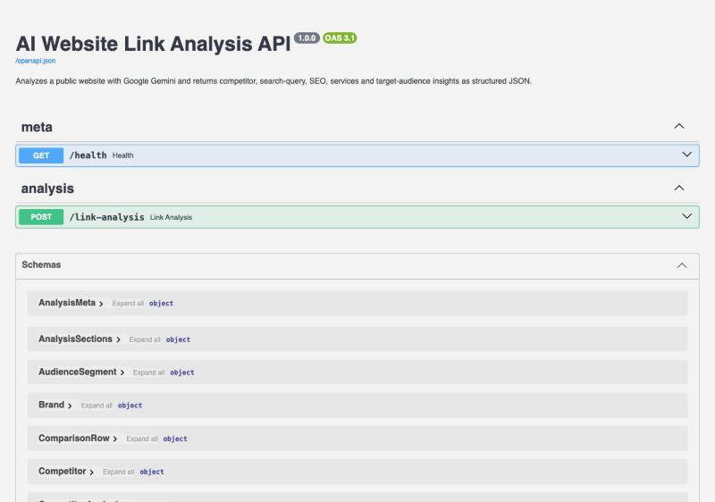

# Sample requests, responses & logs

All output below is **real**, captured from the running API on 18 Nov 2026 with `gemini-3.5-flash-lite`. Nothing was edited by hand.



## 1. Successful analysis

```bash
curl -X POST http://localhost:4000/link-analysis \
  -H "Content-Type: application/json" \
  -d '{"url": "https://www.razorpay.com"}'
```

**Full JSON response:** [`samples/api_response_razorpay.json`](samples/api_response_razorpay.json)  

HTTP 200 · 10.9 s total (1977 ms extraction + 8912 ms LLM) · 3339 in / 3233 out tokens · **$0.009084** · the same URL again returned from cache in about 4 ms.

Pages analyzed: `https://razorpay.com/`, `https://razorpay.com/pricing/`, `https://razorpay.com/freelancer-individual-business/`, `https://razorpay.com/solutions/e-commerce/`

The tables below are a readable view of that JSON.

### Brand
**Razorpay** (Online Payments Infrastructure & Financial Platform). Razorpay is a comprehensive financial platform providing payment solutions, business banking, automated payroll, and credit lines for businesses in India. It enables merchants to accept online, in-store, and international payments with advanced tools like Magic Checkout, Payment Links, and RazorpayX.

### Section 1: Competitor vs your brand

| Competitor | Website | Strengths | Weaknesses / gaps | Source |
|---|---|---|---|---|
| Paytm | paytm.com | Massive consumer brand recognition; Deep offline QR code penetration | Regulatory headwinds; Less developer-focused compared to competitors | `ai_suggested` |
| Cashfree Payments | cashfree.com | Strong payout APIs; Advanced banking integrations | Smaller overall market share than Razorpay; Limited comprehensive business banking suite | `ai_suggested` |
| BillDesk | billdesk.com | Deep enterprise banking relationships; High volume processing stability | Dated user interface; Less tailored for modern startups and D2C brands | `ai_suggested` |

| Aspect | Razorpay | Competitor |
|---|---|---|
| Main Service | Payment Gateway & Full-Stack Financial Platform | Payment Gateway & Payout Solutions (Cashfree Payments) |
| Target Market | Startups, SMEs, Enterprises, and Freelancers | Startups, Enterprises, and Marketplaces (Cashfree Payments) |
| Key Strength | Comprehensive ecosystem including RazorpayX and Payroll | Robust bulk payouts and split-payment solutions (Cashfree Payments) |
| Pricing | 2.15% + GST standard platform fee with custom enterprise plans | Competitive per-transaction rates with custom enterprise tiers (Cashfree Payments) |
| Opportunity | Expand AI-native payment tools and global cross-border features | Build out proprietary business banking and payroll products (Cashfree Payments) |

**Competitive advantages:** India's First AI Payments Foundation Model and agentic payment workflows; All-in-one platform integrating payments, current accounts, and payroll; Magic Checkout delivering 5X faster checkouts and higher conversion rates; Extensive developer documentation and robust integration stack

**Positioning opportunities:** Positioning as the definitive financial operating system for high-growth tech startups; Capturing the freelancer and individual business market with zero-coding payment tools; Expanding cross-border payment capabilities with MoneySaver Export Account

### Section 2: Top 5 target search queries

| Query | Primary platform | Also fits | Intent | Target audience |
|---|---|---|---|---|
| best payment gateway for online payments India | Google | Google | Service Search | E-commerce founders and business owners |
| How to accept international payments securely for my Indian startup | LinkedIn | LinkedIn, Google | B2B Search | SaaS and IT service providers |
| Looking for an easy payment link tool to collect money from customers on Instagram | Instagram | Instagram, Facebook | Inspiration | Freelancers and D2C brand owners |
| Automated payroll software for startups with compliance management | LinkedIn | LinkedIn, Google | Business Discovery | Startup founders and HR managers |
| Compare Razorpay and Cashfree payment gateway success rates | X | X, Google | Comparison | Tech leads and startup executives |

### Section 3: SEO improvements

- **Primary keyword:** Payment Gateway India
- **Secondary:** Online Payments India, Business Banking, Payment Solutions, Automated Payroll
- **Long-tail:** best payment gateway for e-commerce India, accept international payments online India, automated payroll software for startups
- **Business keywords:** Razorpay, Payment Gateway, RazorpayX, Magic Checkout, UPI
- **Current title:** Razorpay - Best Payment Solution for Online Payments India
- **Recommended title (57 chars):** Razorpay: Best Payment Gateway & Online Payments in India
- **Recommended meta description (163 chars):** Start accepting online payments instantly with Razorpay's payment suite. Support UPI, credit cards, netbanking, and international payments with high success rates.
- **Technical observations:** Current meta description is slightly concise but present.; Strong use of internal linking across product suites.; Clear structured data present on the homepage.

| Supporting content | Title | Target keyword |
|---|---|---|
| Comparison page | Razorpay vs Competitors: Why Choose Our Payment Gateway | best payment gateway India |
| Industry page | Payment Solutions for E-Commerce and D2C Brands | payment gateway for e-commerce India |
| Service landing page | RazorpayX Automated Payroll for Startups | automated payroll software for startups |

### Section 4: Top 5 services

| Service | Target industry | Target customer | Main benefit | Evidence |
|---|---|---|---|---|
| Payment Gateway | E-Commerce | Online merchants and startups | Higher conversion rates and lower drop-offs | `from_website` |
| International Payments | SaaS & IT Services | Global-facing businesses | Seamless multi-currency cross-border transactions | `from_website` |
| RazorpayX Current Account | Financial Services | Startup founders and finance teams | Complete financial visibility and automated banking | `from_website` |
| Automated Payroll Solution | All Industries | HR managers and business owners | Error-free compliance and 3-click payroll management | `from_website` |
| Magic Checkout | E-Commerce | D2C brand owners | Reduced RTOs and increased conversion rates | `from_website` |

### Section 5: Target audience

- **Primary:** Startup Founders; E-Commerce Business Owners; Product Managers; Freelancers
- **Secondary:** CFOs and Finance Teams; Developers; HR Managers; Enterprise Executives
- **Industries:** E-Commerce, Education, BFSI, SaaS, Freelance
- **Geographic focus:** India
- **Needs and challenges:** High payment gateway failure rates and cart abandonment; Complex compliance and manual payroll processing; Difficulty accepting international and multi-currency payments; Lack of unified dashboards for banking and payments

| Segment | Business type | Requirement | Channels |
|---|---|---|---|
| D2C E-Commerce Founders | E-Commerce | High checkout success rates and reduced RTOs | Google, Instagram, X |
| SaaS Tech Leads | SaaS | Robust API integrations and international subscription support | Google, LinkedIn, X |
| Startup CFOs | Startups | Automated payroll, tax payments, and corporate cards | Google, LinkedIn |
| Freelancers & Creators | Freelance | No-code payment links and instant settlements | Instagram, Facebook, Google |
| Enterprise Finance Teams | Enterprises | Custom routing, high-volume processing, and escrow accounts | LinkedIn, Google |

### Disclaimers returned by the API

- Competitors are AI-suggested from model knowledge (source='ai_suggested'), not live market research; verify before use.
- No search volumes or rankings are included: they require real data sources (e.g. Google Keyword Planner, platform APIs).
- Services marked evidence='inferred' were not explicitly found on the website.

## 2. Error handling examples

```text
$ POST /link-analysis {"url":"http://169.254.169.254/latest/meta-data"}
{"success":false,"error":{"code":"blocked_url","message":"Access to private or internal network addresses is not allowed."}}
[HTTP 400]

$ POST /link-analysis {"url":"http://localhost:8000/admin"}
{"success":false,"error":{"code":"invalid_url","message":"Port 8000 is not allowed."}}
[HTTP 400]

$ POST /link-analysis {"url":"ftp://example.com"}
{"success":false,"error":{"code":"invalid_url","message":"Unsupported URL scheme 'ftp'. Use http or https."}}
[HTTP 400]

$ POST /link-analysis {"url":"not a url"}
{"success":false,"error":{"code":"invalid_url","message":"URL must contain a fully qualified domain name."}}
[HTTP 400]

$ POST /link-analysis {}
{"success":false,"error":{"code":"invalid_request","message":"url: Field required"}}
[HTTP 422]

$ POST /link-analysis {"url":"https://thisdomaindoesnotexist-xyz123.com"}
{"success":false,"error":{"code":"invalid_url","message":"Could not resolve hostname 'thisdomaindoesnotexist-xyz123.com'."}}
[HTTP 400]

$ POST /link-analysis {"url":"https://www.canva.com"}
{"success":false,"error":{"code":"website_unreachable","message":"Website returned HTTP 403."}}
[HTTP 422]
```

## 3. Server log

```text
INFO:     Started server process [41441]
INFO:     Waiting for application startup.
INFO:     Application startup complete.
INFO:     Uvicorn running on http://0.0.0.0:4000 (Press CTRL+C to quit)
INFO:     127.0.0.1:58479 - "GET /health HTTP/1.1" 200 OK
INFO:     127.0.0.1:58481 - "GET /health HTTP/1.1" 200 OK
2026-11-18 12:51:06,058 INFO link-analysis: Analyzing https://www.razorpay.com
2026-11-18 12:51:06,362 INFO httpx: HTTP Request: GET https://www.razorpay.com/ "HTTP/1.1 301 Moved Permanently"
2026-11-18 12:51:06,537 INFO httpx: HTTP Request: GET https://razorpay.com/ "HTTP/1.1 200 OK"
2026-11-18 12:51:06,914 INFO httpx: HTTP Request: GET https://razorpay.com/solutions/e-commerce/ "HTTP/1.1 200 OK"
2026-11-18 12:51:06,989 INFO httpx: HTTP Request: GET https://razorpay.com/freelancer-unregistered-business/ "HTTP/1.1 301 Moved Permanently"
2026-11-18 12:51:07,062 INFO httpx: HTTP Request: GET https://razorpay.com/freelancer-individual-business/ "HTTP/1.1 200 OK"
2026-11-18 12:51:07,917 INFO httpx: HTTP Request: GET https://razorpay.com/pricing/ "HTTP/1.1 200 OK"
2026-11-18 12:51:16,994 INFO httpx2: HTTP Request: POST https://generativelanguage.googleapis.com/v1/models/gemini-3.5-flash-lite:generateContent "HTTP/1.1 200 OK"
INFO:     127.0.0.1:58483 - "POST /link-analysis HTTP/1.1" 200 OK
2026-11-18 12:51:17,019 INFO link-analysis: Analyzing https://www.razorpay.com
INFO:     127.0.0.1:58493 - "POST /link-analysis HTTP/1.1" 200 OK
2026-11-18 12:51:17,031 INFO link-analysis: Analyzing http://169.254.169.254/latest/meta-data
INFO:     127.0.0.1:58495 - "POST /link-analysis HTTP/1.1" 400 Bad Request
2026-11-18 12:51:17,040 INFO link-analysis: Analyzing http://localhost:8000/admin
INFO:     127.0.0.1:58497 - "POST /link-analysis HTTP/1.1" 400 Bad Request
2026-11-18 12:51:17,049 INFO link-analysis: Analyzing ftp://example.com
INFO:     127.0.0.1:58506 - "POST /link-analysis HTTP/1.1" 400 Bad Request
2026-11-18 12:51:17,058 INFO link-analysis: Analyzing not a url
INFO:     127.0.0.1:58508 - "POST /link-analysis HTTP/1.1" 400 Bad Request
INFO:     127.0.0.1:58510 - "POST /link-analysis HTTP/1.1" 422 Unprocessable Entity
2026-11-18 12:51:17,076 INFO link-analysis: Analyzing https://thisdomaindoesnotexist-xyz123.com
INFO:     127.0.0.1:58512 - "POST /link-analysis HTTP/1.1" 400 Bad Request
2026-11-18 12:51:17,123 INFO link-analysis: Analyzing https://www.canva.com
2026-11-18 12:51:17,357 INFO httpx: HTTP Request: GET https://www.canva.com/ "HTTP/1.1 403 Forbidden"
INFO:     127.0.0.1:58514 - "POST /link-analysis HTTP/1.1" 422 Unprocessable Entity
```

## 4. Per-model outputs from the benchmark

[`samples/`](samples/) also holds the full analysis from each model (`gemini-3.8-flash`, `gemini-3.5-flash-lite`, `gemini-3.1-flash-lite`) for each benchmark site, so the models can be compared side by side.
